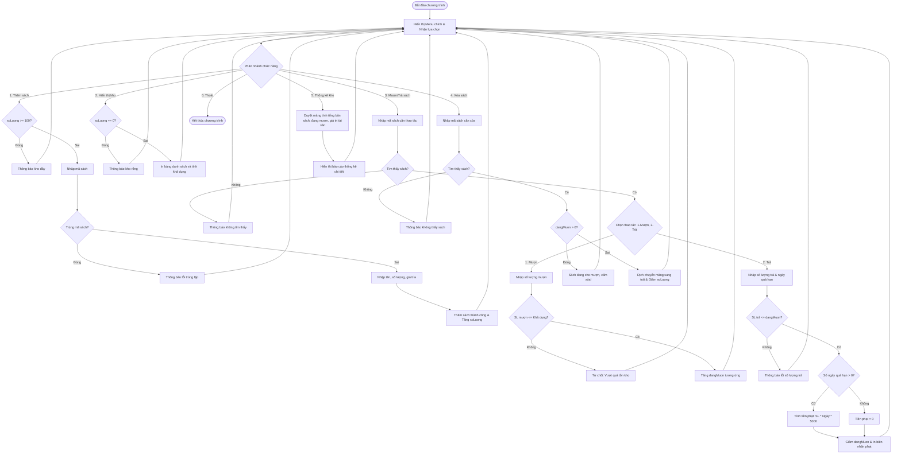

# BÁO CÁO BÀI TẬP LẬP TRÌNH C: XÂY DỰNG PHÂN HỆ KIỂM KÊ KHO SÁCH & THỐNG KÊ MƯỢN TRẢ

> 👤 **Học viên:** Hoàng Công Dũng | **Mã SV:** PTIT-HCM-009
> 🏫 **Môn học:** it102-rl-hoangcongdung

---

## 📊 Sơ đồ thiết kế hệ thống (Activity Diagram)

> 💡 *Sơ đồ dưới đây được render tự động trực tiếp trên GitHub bằng Mermaid. Bạn cũng có thể tải file **`bt4.drawio`** trong repository này để mở và chỉnh sửa trực tiếp trên [Draw.io (diagrams.net)](https://app.diagrams.net).* 

---

## 1. Phân tích bài toán và Ràng buộc kỹ thuật

Bài thực hành yêu cầu xây dựng một ứng dụng Console quản lý kho sách hoàn toàn bằng ngôn ngữ C thuần túy (C11) mà không được sử dụng struct, con trỏ phức tạp hay hàm tự định nghĩa ngoài hàm main(). Do đó, việc áp dụng mảng song song (Parallel Arrays) là phương pháp tối ưu duy nhất để liên kết các thuộc tính của một đầu sách thông qua cùng một chỉ số index.

Hệ thống quản lý tối đa 100 đầu sách thông qua các mảng maSach, tenSach, tongSoLuong, dangMuon và giaBia. Luồng điều khiển được duy trì liên tục bằng vòng lặp do-while kết hợp cấu trúc switch-case.

- Sử dụng mảng song song 1 chiều cùng kích thước MAX = 100.
- Tuân thủ nghiêm ngặt quy tắc không dùng struct hay hàm tách rời.
- Xử lý bộ đệm bàn phím triệt để khi kết hợp scanf() và fgets().

## 2. Hiện thực hóa các Chức năng CRUD và Quy tắc Nghiệp vụ

Chức năng Thêm mới sách kiểm tra biên mảng (soLuong >= 100) và kiểm tra trùng lặp mã sách bằng hàm strcmp(). Trước khi nhận chuỗi có khoảng trắng bằng fgets(), bộ đệm được làm sạch bằng lệnh while(getchar() != '
') để tránh trôi lệnh.

Chức năng Mượn/Trả sách thực hiện đối chiếu mã sách, kiểm tra giới hạn khả dụng (tongSoLuong - dangMuon) khi mượn, và tự động tính tiền phạt quá hạn với công thức 'số lượng trả * số ngày quá hạn * 5000' khi trả sách muộn.

Chức năng Xóa sách áp dụng thuật toán dịch chuyển mảng (Shift array) để lấp chỗ trống. Đặc biệt, hệ thống bảo vệ toàn vẹn dữ liệu bằng cách từ chối xóa nếu sách vẫn đang được cho mượn (dangMuon > 0).

- Kiểm tra trùng mã sách chính xác bằng strcmp().
- Công thức tính tiền phạt: số lượng trả nhân số ngày quá hạn nhân 5000 VNĐ.
- Quy tắc bảo vệ tài sản: Chặn xóa đầu sách nếu dangMuon lớn hơn 0.

## 3. Bảng đặc tả chi tiết các module xử lý trong main()

Bảng dưới đây mô tả chi tiết luồng xử lý và bẫy dữ liệu của từng chức năng trong chương trình:

| Chức năng | Biến / Dữ liệu tác động | Thuật toán & Kiểm chuẩn | Xử lý ngoại lệ / Bẫy dữ liệu |
| --- | --- | --- | --- |
| 1. Thêm mới sách | soLuong, maSach, tenSach, tongSoLuong, giaBia | Dùng strcmp() kiểm tra trùng lặp từ 0 đến soLuong - 1 | Báo lỗi và hủy thêm nếu kho đầy hoặc trùng mã |
| 2. Hiển thị kho | tongSoLuong, dangMuon | Tính khả dụng = tongSoLuong - dangMuon | In thông báo kho rỗng nếu soLuong bằng 0 |
| 3. Mượn / Trả sách | dangMuon, số ngày quá hạn | So sánh SL mượn với khả dụng; tính tiền phạt quá hạn | Từ chối mượn nếu vượt tồn kho; chặn trả quá SL đang mượn |
| 4. Xóa đầu sách | soLuong, các mảng song song | Dịch chuyển phần tử từ pos + 1 sang trái 1 vị trí | Từ chối xóa tuyệt đối nếu sách đang được cho mượn |
| 5. Thống kê kho | tongSoLuong, dangMuon, giaBia | Duyệt vòng lặp tính tổng bản sách, tổng mượn, tổng giá trị | Hiển thị báo cáo chi tiết tài sản kho sách |

## 4. Hướng dẫn biên dịch và Kiểm thử mã nguồn

Mã nguồn được viết hoàn chỉnh trong file duy nhất main.c, tuân thủ chuẩn ANSI C.

Để biên dịch và chạy chương trình trên môi trường Terminal hoặc Visual Studio Code, sử dụng câu lệnh: gcc -Wall main.c -o main và chạy lệnh ./main.

- Biên dịch thành công không phát sinh cảnh báo (-Wall).
- Đảm bảo không rò rỉ bộ nhớ và không dùng thư viện ngoài.

---

## 📁 Danh sách tệp tin nộp bài trong Repository
- 📝 `bt4.docx`: Báo cáo tài liệu phân tích nghiệp vụ hoàn chỉnh.
- 🎨 `bt4.drawio`: File thiết kế sơ đồ chuẩn theo quy định đề bài (mở trực tiếp bằng [Draw.io](https://app.diagrams.net) hoặc Lucidchart).
- 💻 `main.c`: Mã nguồn chương trình.
